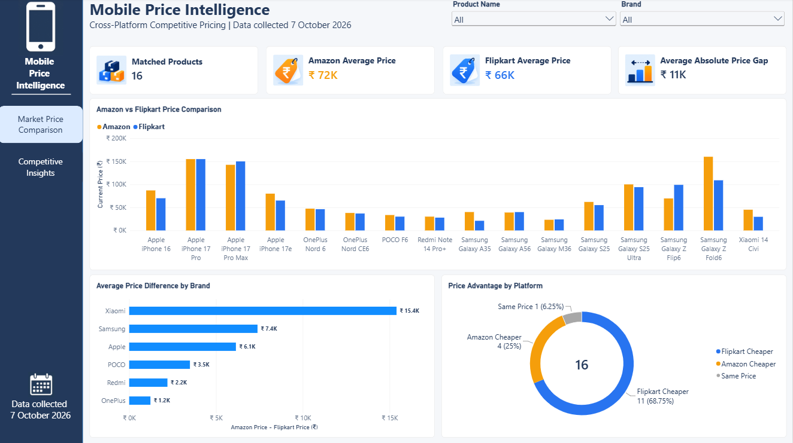
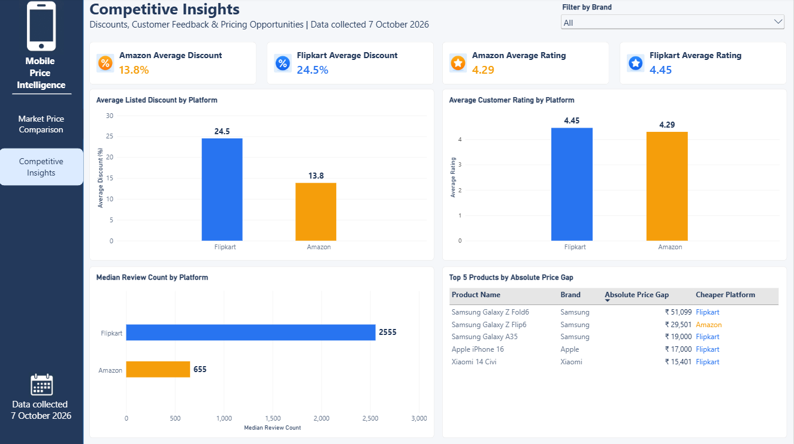

# Mobile Price Intelligence & Cross-Platform Competitive Analysis

**A Python and Power BI project comparing mobile-phone prices, listed discounts, customer ratings, and review volume across Amazon and Flipkart.**

> **Data snapshot:** 7 October 2026  
> **Tools:** Python, Pandas, NumPy, Requests, BeautifulSoup, Playwright, Jupyter Notebook, Matplotlib, Seaborn, Power BI, and DAX

## Table of Contents

- [Overview](#overview)
- [Problem Statement](#problem-statement)
- [Dataset](#dataset)
- [Tools and Technologies](#tools-and-technologies)
- [Methods](#methods)
- [Key Insights](#key-insights)
- [Dashboard, Model, and Output](#dashboard-model-and-output)
- [How to Run This Project](#how-to-run-this-project)
- [Results and Conclusion](#results-and-conclusion)
- [Future Work](#future-work)
- [GitHub Repository Structure](#github-repository-structure)
- [Author and Contact](#author-and-contact)

## Overview

The same mobile phone can have different prices, discounts, ratings, and review counts on different e-commerce platforms. Product titles and RAM/storage configurations may also differ, making direct comparisons unreliable without standardization.

This project collects mobile listing data from Amazon and Flipkart, validates and cleans it, standardizes product information, matches equivalent product variants, and analyzes the differences. The findings are presented in a two-page interactive Power BI dashboard to support cross-platform competitive pricing analysis.

## Problem Statement

Comparing mobile listings across platforms is difficult when product titles and configurations are inconsistent or when source data contains missing and invalid values. The goal of this project is to create a reliable comparison of equivalent mobile product variants and investigate:

1. Which platform is more price-competitive across comparable products?
2. What is the typical cross-platform price gap?
3. Which products have the largest pricing differences?
4. Which brands show the greatest pricing variation?
5. Do higher discounts translate into greater price competitiveness?
6. When one platform is cheaper, does it also have a lower customer rating?
7. Which platform has stronger customer engagement based on review volume?
8. Where are the biggest competitive pricing opportunities?

## Dataset

The project uses mobile product listings collected from Amazon and Flipkart on **7 October 2026**.

- **Raw listings:** 44 total — 22 from Amazon and 22 from Flipkart.
- **Matched variants:** 16 product variants matched across both platforms.
- **Unmatched variants:** 6 listings from each platform remained unmatched in the matching report.
- **Main attributes:** Product name, brand, RAM, storage, current price, MRP, discount, rating, review count, availability, product URL, and scraping timestamp.
- **Comparison metrics:** Signed price difference, absolute price gap, discount difference, rating difference, review difference, and cheaper platform.

Raw and processed data are stored in `data/raw/` and `data/processed/`. Missing MRP and discount values are treated as unknown rather than as zero.

## Tools and Technologies

| Tool / Technology | Purpose |
|---|---|
| Python | Main programming language for data collection and processing |
| Playwright | Browser-based collection from Amazon product pages |
| Requests | HTTP requests for Flipkart product pages |
| BeautifulSoup | Parsing HTML to extract listing information |
| Regular Expressions (`re`) | Extracting prices, ratings, RAM, storage, and model names from text |
| Pandas and NumPy | Data validation, cleaning, transformation, matching, and analysis |
| Matplotlib and Seaborn | Exploratory data analysis and visualizations |
| Jupyter Notebook | Running and documenting EDA |
| Power BI and DAX | Data modelling, measures, interactive visuals, and dashboard reporting |

## Methods

1. **Data collection:** Collected mobile listing information from Amazon and Flipkart using Python scraping scripts.
2. **Data validation:** Checked source schemas, row counts, missing values, duplicate records, and key field validity.
3. **Data cleaning:** Converted prices and other fields to appropriate types, standardized values, and retained unavailable values as null.
4. **Product standardization:** Standardized brand and model names and extracted RAM and storage capacity from product titles where possible.
5. **Product matching:** Created normalized matching keys using brand, model, RAM, and storage. For iPhones, where RAM was unavailable, matching used product name and storage capacity.
6. **Comparison metrics:** Calculated price difference, absolute price gap, discount difference, rating difference, review difference, and the cheaper platform.
7. **EDA:** Investigated the eight business questions using summary statistics and visualizations.
8. **Power BI reporting:** Built a two-page report to communicate the findings and allow users to explore products and brands.

For detailed workflow and metric definitions, see [`docs/methodology.md`](docs/methodology.md).

## Key Insights

The following findings describe this captured sample only; they should not be interpreted as long-term marketplace trends.

- **44 raw listings** were collected: 22 from Amazon and 22 from Flipkart.
- **16 product variants** were matched across both platforms, while 6 listings per platform remained unmatched.
- Of the 16 matched variants, **Flipkart was cheaper for 11**, **Amazon was cheaper for 4**, and **1 had the same price**.
- The mean signed price gap (**Amazon price − Flipkart price**) was approximately **₹6,243**.
- The mean absolute price gap was approximately **₹11,077**.
- Average listed discount was **13.8% for Amazon** (13 valid values) and **24.5% for Flipkart** (12 valid values). Each platform's average uses its own available non-missing discount values.
- Average ratings were approximately **4.29 for Amazon** and **4.45 for Flipkart**.
- Median review counts were **655 for Amazon** and **2,555 for Flipkart**.

**Discount interpretation:** The platform-level averages use all valid values available for each platform. For an apples-to-apples paired discount comparison, use only the 11 matched products with a valid discount on both platforms. Missing discounts are unknown, not zero.

## Dashboard

### Page 1 — Market Price Comparison

This page presents matched product count, platform average prices, average absolute price gap, product-level price comparisons, average signed price difference by brand, and the distribution of price advantage by platform. Product and brand slicers allow filtering.



### Page 2 — Competitive Insights

This page compares average listed discounts, average customer ratings, median review counts, and the top five products by absolute price gap. A brand slicer supports focused comparisons.



### Power BI Data Model

The report uses a simple three-table model:

- **DimProduct:** Product attributes such as brand, product name, RAM, and storage.
- **DimPlatform:** Platform names — Amazon and Flipkart.
- **FactProductPlatform:** Product-platform observations, including price, MRP, discount, rating, review count, and availability.

The model connects each dimension to the fact table through one-to-many relationships.

### Main Outputs

- Cleaned Amazon and Flipkart datasets
- Standardized product datasets
- Final matched comparison dataset
- Product matching report for unmatched variants
- EDA notebook and output dataset
- Power BI report with two dashboard pages

## How to Run This Project

### 1. Clone the repository

```bash
git clone https://github.com/Pronoy-2003/mobile-price-intelligence.git
cd mobile-price-intelligence
```

### 2. Install dependencies

```bash
pip install -r requirements.txt
playwright install chromium
```

The browser installation is required for the Playwright-based scraper.

### 3. Run the Python pipeline

Run the scripts from the repository root, in this order:

```bash
python python/01_amazon_scraper.py
python python/02_flipkart_scraper.py
python python/03_validate_data.py
python python/04_clean_data.py
python python/05_standardize_products.py
python python/06_product_matching.py
```

The scraper scripts may access live websites, and website layouts or access rules can change. Respect each website's terms and access restrictions. If you only want to review the existing analysis, use the committed processed datasets and notebook instead of rerunning the scrapers.

### 4. Run the EDA notebook

Open `notebooks/mobile_price_eda.ipynb` in Jupyter Notebook or JupyterLab and run the cells in order. Confirm that the required processed CSV files are present.

### 5. Open the Power BI report

Open `powerbi/mobile_price_intelligence.pbix` in Power BI Desktop. If prompted, update data source paths to match your local repository location and refresh the data.

## Results and Conclusion

This project demonstrates an end-to-end analytics workflow, from web scraping and data validation to product matching, EDA, and interactive Power BI reporting. In the captured sample, Flipkart had the lower listed price for most matched variants, and its available listings also showed a higher average listed discount and average rating. The largest observed price gaps point to products worth investigating further.

These results apply only to the 16 matched variants in a single-day snapshot. They do not establish long-term price trends, overall marketplace superiority, or a causal relationship between discounts, ratings, and prices.

## Future Work

1. Collect price data regularly to analyze price trends over time.
2. Expand the dataset to include more mobile models and brands.
3. Improve product matching to handle differences in product titles and configurations.
4. Add more e-commerce platforms for broader price comparisons.
5. Automate data collection, validation, and dashboard refreshes.


## GitHub Repository Structure

```text
mobile-price-intelligence/
├── data/
│   ├── raw/
│   │   ├── amazon_scraped_data.csv
│   │   ├── amazon_scraped_data.json
│   │   └── flipkart_scraped_data.csv
│   ├── processed/
│   │   ├── amazon_cleaned.csv
│   │   ├── amazon_standardized.csv
│   │   ├── flipkart_cleaned.csv
│   │   ├── flipkart_standardized.csv
│   │   ├── final_mobile_price_comparison.csv
│   │   ├── final_mobile_price_comparison_eda.csv
│   │   └── product_matching_report.csv
│   └── .gitkeep
├── docs/
│   ├── Project_Documentation.md
│   ├── business_problem.md
│   ├── data_dictionary.md
│   └── methodology.md
├── images/
│   ├── 01_market_price_comparison.png
│   └── 02_competitive_insights.png
├── notebooks/
│   └── mobile_price_eda.ipynb
├── powerbi/
│   └── mobile_price_intelligence.pbix
├── python/
│   ├── 01_amazon_scraper.py
│   ├── 02_flipkart_scraper.py
│   ├── 03_validate_data.py
│   ├── 04_clean_data.py
│   ├── 05_standardize_products.py
│   ├── 06_product_matching.py
│   └── __init__.py
├── .gitignore
├── LICENSE
├── README.md
└── requirements.txt
```

> Repository structure reflects the project files currently documented for this repository. If you rename or remove files, update this tree to match the actual GitHub contents.


## Author and Contact

**Author:** Pronoy Pryunkush Sonowal

-   **GitHub:** https://github.com/Pronoy-2003
-   **LinkedIn:** www.linkedin.com/in/pronoy-pryunkush-sonowal
-   **Email:** pronoypryunkushsonowal2002@gmail.com

---

**Responsible use:** Respect website terms and access restrictions. Do not commit passwords, API keys, cookies, session tokens, or other secrets. Publish scraped data only when redistribution is appropriate; otherwise, share permitted sample data, schemas, and reproduction instructions.
